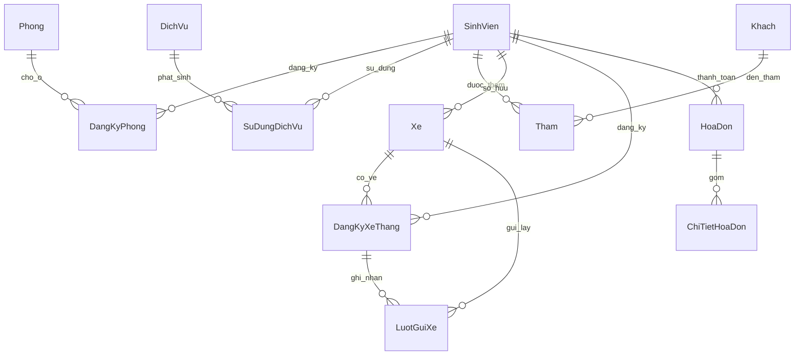

# Quản lý ký túc xá — Project 2 môn Cơ sở dữ liệu

Ứng dụng Flask + MySQL 8.0, gồm **4 truy vấn bắt buộc và 10 truy vấn bổ sung**. Mỗi truy vấn có mã Q01–Q14, câu SQL, tham số lọc và kết quả hiển thị trong **Báo cáo & truy vấn**. Các thao tác thêm/sửa/xóa không được cộng vào số 10 truy vấn bổ sung này.

## Chạy ứng dụng

Muốn người dùng mở website mà không phải cài MySQL: xem [hướng dẫn triển khai cloud](deployment/README.md). Dự án có cấu hình Railway/Render, kết nối MySQL qua host/port và công cụ khởi tạo database cloud trống.

```powershell
pip install -r requirements.txt
python run.py
```

Mở `http://127.0.0.1:5000`. Cấu hình MySQL trong `.env`:

```env
MYSQL_HOST=localhost
MYSQL_USER=root
MYSQL_PASSWORD=mat_khau_mysql_cua_ban
MYSQL_DB=ql_ktx
SECRET_KEY=thay_bang_chuoi_ngau_nhien_rieng
```

Nâng cấp database đang có từ SQL gốc:

```powershell
python -m database.manage migrate
```

Lệnh này lưu bản sao bảng, dữ liệu và định nghĩa trigger vào `database/backups/` trước khi bổ sung schema và thay các trigger nghiệp vụ. Không nạp dữ liệu mẫu vào database đang dùng. Thư mục backup đã được loại khỏi Git.

Tạo một database mới để nộp bài/demo độc lập (tên này phải chưa có bảng):

```powershell
python -m database.manage init --database ql_ktx_demo --sample
```

Sau đó đổi `MYSQL_DB=ql_ktx_demo` và chạy lại ứng dụng. Dữ liệu mẫu mới dùng **tháng 10/2026**, tài khoản `admin/admin123`. Đổi mật khẩu khi dùng ngoài môi trường demo.

**Dữ liệu SQL cũ của bài nằm ở tháng 10/2024.** Khi xem bản dữ liệu cũ, chọn tháng 10, năm 2024. Các tháng không có phát sinh dịch vụ sẽ trả về 0 hoặc danh sách trống theo đúng điều kiện truy vấn.

## Bộ truy vấn để bảo vệ

Nguồn SQL duy nhất: `database/queries.sql`. Ứng dụng đọc chính các câu lệnh trong file này; có thể xem SQL ở cuối trang báo cáo.

| Mã | Nội dung | Kỹ thuật chính |
|---|---|---|
| Q01 | Tổng tiền từng sinh viên/tháng: phòng, dịch vụ, vé xe, phí vượt lượt | CTE, JOIN, GROUP BY, SUM, COALESCE |
| Q02 | Sinh viên + dịch vụ + tổng tiền trong khoảng ngày | JOIN, GROUP BY, SUM |
| Q03 | Sinh viên + thông tin khách + số lần thăm theo tuần/tháng | JOIN, COUNT, MAX, GROUP BY |
| Q04 | Danh mục và doanh thu từng dịch vụ/tháng, gồm cả dịch vụ doanh thu 0 | LEFT JOIN, SUM, COALESCE |
| Q05 | Phòng còn chỗ tại ngày chọn | LEFT JOIN, COUNT, HAVING |
| Q06 | Phòng đã đầy tại ngày chọn | LEFT JOIN, COUNT, HAVING |
| Q07 | Sinh viên nội trú chưa dùng dịch vụ | EXISTS, NOT EXISTS |
| Q08 | Sinh viên dùng ít nhất hai loại dịch vụ | COUNT DISTINCT, HAVING |
| Q09 | Top 10 sinh viên chi tiêu dịch vụ cao nhất tháng | GROUP BY, ORDER BY, LIMIT |
| Q10 | Dịch vụ doanh thu cao nhất tháng, giữ cả trường hợp đồng hạng | CTE, DENSE_RANK |
| Q11 | Khách đến thăm nhiều nhất, giữ cả trường hợp đồng hạng | COUNT, DENSE_RANK |
| Q12 | Xe vượt hai lượt miễn phí trong ngày và tổng phí | JOIN, GROUP BY, HAVING |
| Q13 | Công nợ từng sinh viên đến hết tháng chọn | SUM, COUNT, MIN, GROUP BY |
| Q14 | Dịch vụ chưa được sử dụng trong khoảng ngày | NOT EXISTS |

Q01–Q04 là yêu cầu gốc; Q05–Q14 là **10 truy vấn bổ sung**. Bộ lọc mã SV áp dụng cho Q01–Q03. Truy vấn theo tháng dùng tháng/năm; truy vấn theo khoảng ngày hỗ trợ tháng, tuần thứ Hai–Chủ nhật và ngày bắt đầu/kết thúc tự chọn. Ngày kết thúc trên giao diện được tính hết ngày đó.

Trong Workbench, chọn schema cần xem rồi chạy `queries.sql`. Các biến `@ky_thang`, `@thang_sau`, `@tu_ngay`, `@den_ngay`, `@ma_sv` ở đầu file là tham số; `@den_ngay` là cận trên không bao gồm. Ví dụ tháng 10/2024 dùng `2024-10-01` và `2024-11-01`.

## Nghiệp vụ và ràng buộc

- Tiền phòng tính nguyên tháng khi có ít nhất một ngày ở. Mỗi sinh viên/phòng chỉ tính một lần trong tháng; quay lại cùng phòng không bị tính hai lần. Nếu chuyển sang phòng khác trong tháng, mỗi phòng phát sinh một khoản nguyên tháng. Nếu cùng phòng có nhiều đơn giá đăng ký trong tháng, áp dụng giá cao nhất của các đăng ký đó.
- Một sinh viên không được có hai đăng ký phòng trùng ngày; số người đồng thời không vượt sức chứa. Có thể ghi ngày trả phòng và giữ lại lịch sử. Ngày kết thúc được tính là ngày còn ở; chuyển phòng sang ngày kế tiếp.
- Mỗi xe lưu ngày đăng ký. Vé tháng được đăng ký/gia hạn rõ ràng trong mục **Vé xe tháng**, phí cố định 100.000đ/xe/tháng. Mỗi SV tối đa hai vé hoạt động trong cùng tháng. Lưu xe chưa đồng nghĩa với đăng ký vé cho mọi tháng.
- Một bản ghi lượt xe là một chu kỳ gửi vào rồi lấy ra. Hạn mức theo ngày gửi: hai lượt đầu miễn phí, từ lượt thứ ba 3.000đ/lượt; ngày mới có lại hai lượt miễn phí. Đây là quy ước phù hợp với trigger và dữ liệu mẫu gốc. Xe vãng lai được thu riêng và không ghi vào bảng xe vé tháng.
- Khi thêm lượt lùi ngày, sửa hoặc xóa lượt, ứng dụng tính lại và **lưu** phí của các lượt bị ảnh hưởng trong cùng transaction. Danh sách, form sửa, hóa đơn và báo cáo cùng dùng phí đã lưu. Không cho gửi hai lượt bị chồng thời gian.
- Dịch vụ giữ đơn giá tại thời điểm phát sinh. Đổi giá danh mục không làm thay đổi lượt cũ; sửa số lượng của cùng dịch vụ vẫn giữ giá lịch sử. Nếu đổi sang dịch vụ khác thì lấy giá dịch vụ mới.
- `XE_THANG`, `XE_PHAT` là hai mã dịch vụ dành riêng cho vé và phí xe. Không nhập lại các phí này ở form sử dụng dịch vụ. View `v_phat_sinh_dich_vu` gộp dịch vụ thường, vé tháng và phí vượt lượt để báo cáo không bỏ sót doanh thu.
- Mỗi sinh viên có tối đa một hóa đơn/tháng. Bản đã lưu đọc từ `ChiTietHoaDon`; hóa đơn chưa thanh toán chỉ cập nhật khi chọn **Cập nhật hóa đơn từ phát sinh**. Hóa đơn đã thanh toán và các phát sinh tính tiền của tháng đó bị khóa ở cả ứng dụng và trigger CSDL.
- Khi nâng cấp dữ liệu cũ, lịch sử gửi xe được liên kết với vé của đúng tháng có lượt gửi. Không tạo vé cho các tháng không có căn cứ. Với dữ liệu cũ không lưu giá lịch sử, giá được chốt theo giá danh mục tại thời điểm chạy migration; không thể phục hồi giá cũ chưa từng được lưu.

## Cấu trúc CSDL

`schema.sql` tạo 13 bảng; `domain.sql` tạo 3 view, 3 procedure kiểm tra nghiệp vụ và 18 trigger. Hai tên view cũ `v_doanhthu_dichvu`, `v_khach_tham` vẫn được giữ; Q03 dùng ngày gốc từ bảng `Tham` để lọc đúng tuần/tháng.



`Users` quản lý tài khoản đăng nhập độc lập. Các bảng quan hệ dùng khóa ngoại; mã SV, số phòng, biển số, mã dịch vụ là khóa định danh. Các bảng phát sinh có mã riêng nên cho phép một SV sử dụng cùng dịch vụ hoặc tiếp cùng khách nhiều lần. Đơn giá áp dụng và chi tiết hóa đơn là dữ liệu giao dịch cần giữ lịch sử.

## Kịch bản demo và kết quả đối chiếu

Với `sample_data.sql`, chọn tháng **10/2026**:

| Sinh viên | Tiền phòng | Dịch vụ thường | Vé tháng | Phí vượt | Tổng |
|---|---:|---:|---:|---:|---:|
| SV01 | 500.000 | 105.000 | 200.000 | 3.000 | 808.000 |
| SV02 | 500.000 | 70.000 | 100.000 | 0 | 670.000 |
| SV03 | 600.000 | 0 | 0 | 0 | 600.000 |
| SV04 | 400.000 | 0 | 0 | 0 | 400.000 |

Doanh thu dịch vụ Q04 là **478.000đ**, gồm 175.000đ dịch vụ thường + 300.000đ vé xe + 3.000đ phí vượt. SV03 ở đúng một ngày 31/10 vẫn tính 600.000đ. DV04 chưa sử dụng nên doanh thu bằng 0. Q07 trả SV03, SV04. Khách A đến SV01 hai lần trong tháng, một lần trong tuần chứa ngày 27/10.

Với SQL mẫu gốc của bạn sau nâng cấp, chọn **10/2024**: SV01 **783.000đ**, SV02 **615.000đ**, SV03 **890.000đ**; doanh thu dịch vụ Q04 **488.000đ**.

Thứ tự demo:

1. Mở Q01–Q04, kiểm tra số tiền, lọc theo một SV, đổi tuần/tháng và in kết quả.
2. Chọn lần lượt Q05–Q14, mở phần **Xem SQL** để giải thích JOIN, GROUP BY, HAVING, NOT EXISTS và xếp hạng.
3. Thử thêm người vào phòng đầy, đăng ký phòng trùng ngày hoặc vé tháng thứ ba: CSDL từ chối.
4. Xem ba lượt cùng ngày có phí `0, 0, 3000`; thêm lùi giờ hoặc xóa lượt, kiểm tra phí các lượt còn lại.
5. Đổi giá giặt là rồi sửa số lượng lượt cũ: giá cũ vẫn giữ.
6. Lập hóa đơn, sửa phát sinh khi chưa thanh toán: chi tiết đã lưu giữ nguyên đến khi bấm cập nhật. Xác nhận thanh toán rồi thử sửa nguồn tính tiền: hệ thống từ chối.

## Kiểm thử

```powershell
python -m database.manage init --database ql_ktx_verify_demo --sample
python tests/check_database.py --database ql_ktx_verify_demo
```

Kiểm thử chỉ chấp nhận database có tiền tố `ql_ktx_verify_`; mỗi ca rollback dữ liệu. Các ca kiểm tra SQL, số tiền kỳ vọng, lịch sử giá, tính lại phí xe, giới hạn phòng/vé, khóa hóa đơn và trang HTTP.

`tests/check_form_interaction.cjs` dùng Playwright kiểm tra click/nhập và mở/đóng popup trên desktop/mobile với template thật, dữ liệu mẫu trong bộ nhớ, không gửi form vào CSDL. Có thể đặt `PLAYWRIGHT_CHROMIUM_EXECUTABLE_PATH` nếu Chromium đã được cài ở vị trí riêng.
